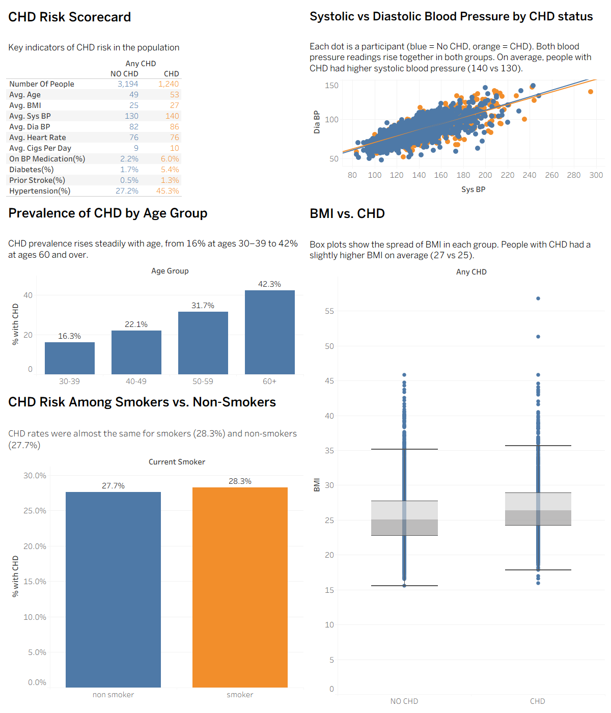
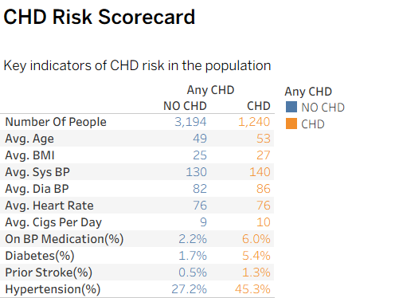
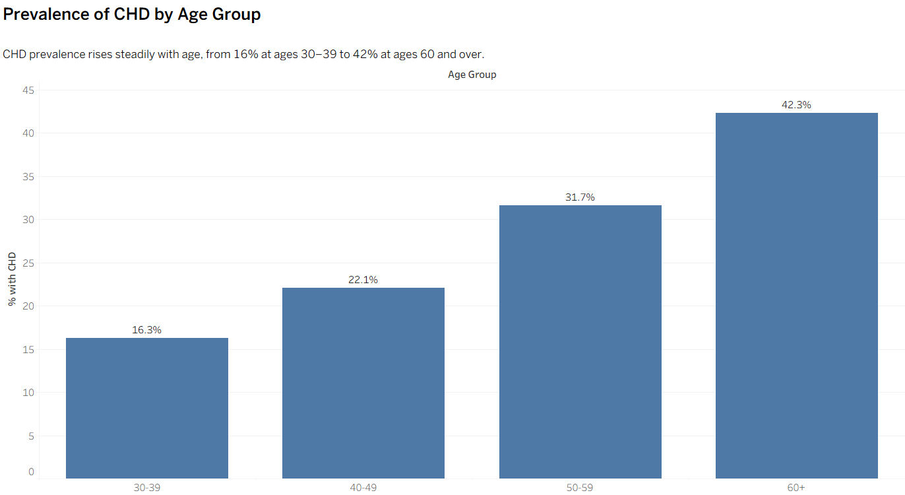
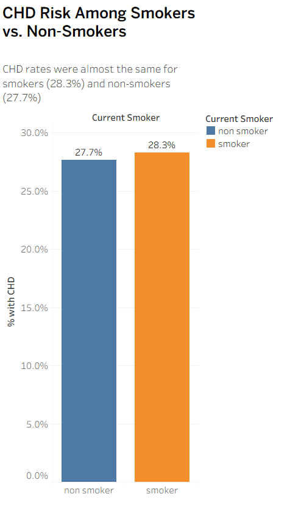
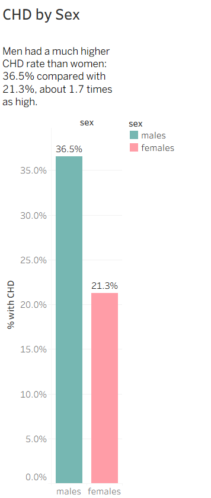
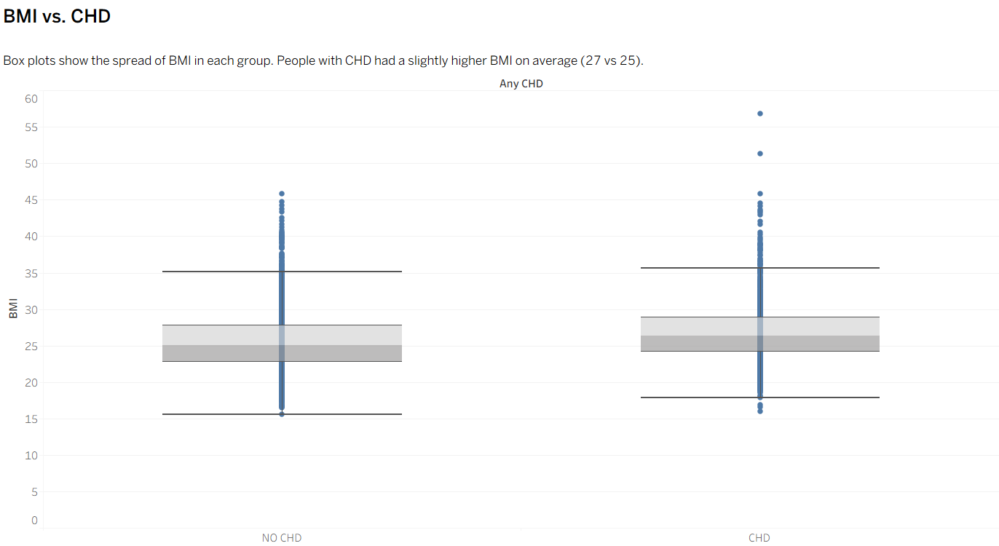
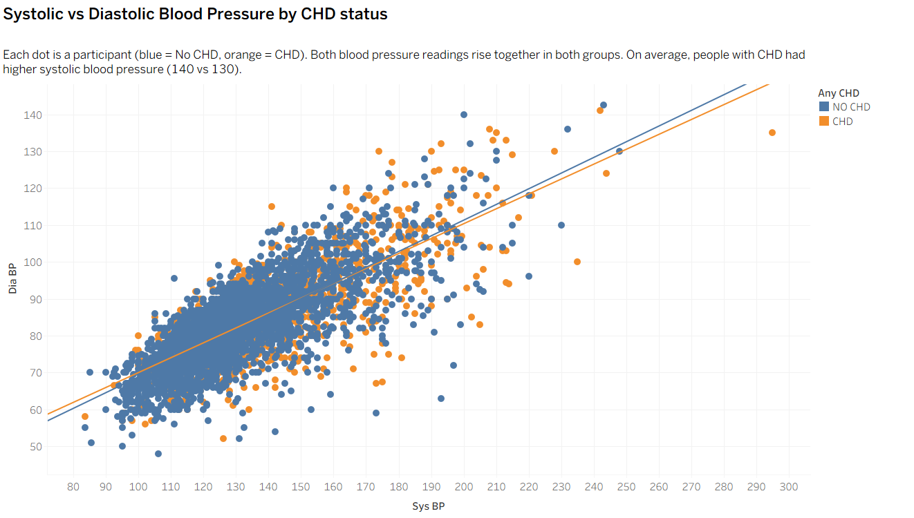

# Coronary Heart Disease Risk Factors: Framingham Heart Study Dashboard

An exploratory analysis and Tableau dashboard comparing participants who developed coronary heart disease (CHD) with those who did not, across age, sex, blood pressure, BMI, smoking and medical history.

**Full written report:** [Coronary Heart Disease Risk Factors: Framingham Heart Study Analysis (PDF)](report/Coronary_Heart_Disease_Risk_Factors_Framingham_Heart_Study_Analysis.pdf)



**Type:** Course project, Master of Professional Studies in Analytics, Northeastern University

**Tools:** Tableau Desktop (calculated fields, box plots, trend lines, dashboard layout)

**Data:** Framingham Heart Study dataset, 4,434 participants, 26 fields (not included in this repository; see [Data](#data))

---

## Question

Which participant characteristics are associated with developing coronary heart disease, and how large are the differences between the CHD and No CHD groups?

## Key findings

1. **CHD becomes much more common with age.** 16.3% of participants aged 30–39 had CHD, rising to 42.3% of those aged 60 and over.
2. **Men had a much higher CHD rate than women:** 36.5% compared with 21.3%, about 1.7 times as high. This is the largest difference between any two groups in the analysis.
3. **Participants with CHD had higher blood pressure.** Average systolic blood pressure was 140 vs 130, and 45.3% had hypertension compared with 27.2% of the No CHD group.
4. **Diabetes was about three times as common in the CHD group** (5.4% vs 1.7%), as was use of blood pressure medication (6.0% vs 2.2%).
5. **BMI was slightly higher in the CHD group** (average 27 vs 25), with heavily overlapping distributions.
6. **Smoking status alone showed almost no difference.** 28.3% of smokers and 27.7% of non-smokers had CHD. Because the CHD group was also older on average, comparing smokers and non-smokers within each age group would be a useful next step.

These are associations in this dataset, not evidence that any factor causes CHD.

---

## Charts

### 1. CHD Risk Scorecard
Average profile of participants with and without CHD.



| Indicator | No CHD | CHD |
| --- | --- | --- |
| Number of people | 3,194 | 1,240 |
| Average age | 49 | 53 |
| Average BMI | 25 | 27 |
| Average systolic BP | 130 | 140 |
| Average diastolic BP | 82 | 86 |
| Average heart rate | 76 | 76 |
| Average cigarettes per day | 9 | 10 |
| On BP medication | 2.2% | 6.0% |
| Diabetes | 1.7% | 5.4% |
| Prior stroke | 0.5% | 1.3% |
| Hypertension | 27.2% | 45.3% |

### 2. Prevalence of CHD by age group


### 3. CHD among smokers vs non-smokers


### 4. CHD by sex
Men had a much higher CHD rate than women (36.5% vs 21.3%).



### 5. BMI vs CHD
Box plots of BMI for each group, with one mark per participant.



### 6. Systolic vs diastolic blood pressure by CHD status
Each dot is a participant, with a trend line for each group.



---

## Method

- **Age groups:** a calculated field groups age into 30–39, 40–49, 50–59 and 60+. Ages 70–79 were merged into 60+ because only 2 participants fell in that range, too few to report a separate rate.
- **Rates:** CHD and condition rates use the average of 0/1 fields (for example, the average of `Any CHD` is the share of participants with CHD).
- **Averages:** continuous measures (age, BMI, blood pressure, heart rate, cigarettes per day) use averages, not totals.
- **BMI box plots:** measures are disaggregated so each participant is one mark. 19 participants with no BMI recorded are excluded.

## Data

This analysis uses a version of the Framingham Heart Study dataset provided for coursework (`framingham_2024-1.csv`, 4,434 rows, 26 fields). The raw data is **not included** in this repository because it was provided for coursework and may not be redistributed. The dashboard images and the method above describe the work without the underlying records.

## Repository contents

```
README.md                This overview
calculated_fields.txt    Tableau calculated field formulas
images/                  Dashboard and individual chart images (PNG)
report/
  Coronary_Heart_Disease_Risk_Factors_Framingham_Heart_Study_Analysis.pdf
                         Full written report: data, method, findings, correlations, limitations
  CHD_Risk_Dashboard.pdf Dashboard exported as PDF
```

## Limitations and next steps

- Results describe associations only; no statistical tests or models were applied yet. All correlations with CHD were weak (below 0.25).
- The smoking comparison does not adjust for age. A next step is to compare CHD rates for smokers and non-smokers within each age group, or fit a logistic regression with several risk factors together.
- Participants with missing values are excluded from the affected measures.

---

**Author:** Rita Manzie · [LinkedIn](https://www.linkedin.com/in/rita-manzie-328188259)
